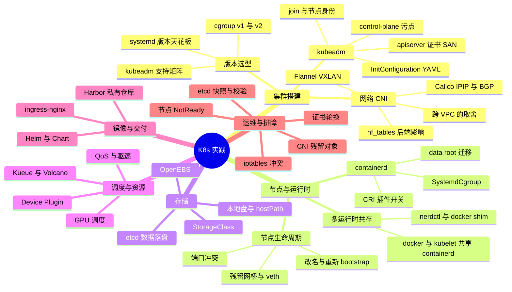

# K8s 专题

按「先能跑起来，再谈用得好」的顺序整理。所有内容来自真实机器上的搭建和排障，不是文档翻译。

## 知识体系

## 阅读路径

如果你要从零搭一套集群，按这个顺序读：

1. **先算版本天花板** — 查 cgroup 版本和 systemd 版本，决定能上到哪个 k8s 大版本
2. **再看 iptables 后端** — nf_tables 环境下 CNI 选型会变
3. **master 初始化** — 用 YAML 配置而不是长命令行，证书 SAN 一次配全
4. **worker join** — 节点身份、CNI 初始化、残留网络对象，这三处最容易翻车
5. **存储与镜像仓库** — 有状态服务上集群之前先解决
6. **调度与 GPU** — 只在需要跑推理或训练时看

## 文章

### 集群搭建与网络

- [从裸机到双节点 K8s v1.34 集群 — 四个把人卡住的坑](/blog/2026/11/18/k8s-cluster-bringup-four-traps)
  版本天花板怎么算、CNI 怎么选，以及 join worker 时的四个坑：证书 CN 写死、CNI watcher 卡死、cni0 残留网段、10248 端口冲突。

### 存储

- [Kubernetes 默认 StorageClass — OpenEBS 安装](/blog/2026/07/31/kubernetes-default-storageclass-openebs)
  给没有云厂商 CSI 的自建集群配一套默认存储，解决 PVC 一直 Pending 的问题。

### 运行时

- [没有 docker daemon 的节点，怎么让 docker 命令照常工作？](/blog/2026/08/06/nerdctl-docker-shim)
  k8s 1.24 移除 dockershim 之后，运维习惯怎么平移。
- [CentOS 7 + nerdctl 服务器编译 llama.cpp 完整指南](/blog/llama-cpp-centos7-nerdctl-build)
  在容器化节点上做本地编译，顺带展示没有 docker daemon 时的构建工作流。

### 调度与资源

- [K8s 上的 GPU 调度：从 Device Plugin 到 Kueue/Volcano 的推理集群资源管理](/blog/2026/08/20/kubernetes-gpu-scheduling-deep-dive)
  从最底层的 Device Plugin 讲到队列级调度，推理集群怎么把卡用满。

### 镜像与交付

- [Harbor 私有镜像仓库搭建 — k8s + 面板 + ingress-nginx 完整实录](/blog/2026/08/03/harbor-registry-install)
  自建 registry 的完整路径，包括 ingress 和证书的配置细节。

## 常见故障速查

排 K8s 问题的第一条经验：**日志里的报错通常不是真正的原因**。看 containerd 日志和内核网络对象，比只看 pod 事件有效得多。

| 现象 | 真正的根因 | 排查入口 |
|---|---|---|
| 节点 Ready，但 pod 全部 `ContainerCreating` | CNI 网桥残留旧网段 | `ip -4 addr show cni0` |
| 节点 `Ready=False`，但 flannel pod 是 Running | containerd 的 CNI watcher 挂了 | `journalctl -u containerd` 搜 cni |
| 改名后节点再也注册不上 | kubelet 客户端证书 CN 写死旧名字 | `openssl x509 -in /var/lib/kubelet/pki/kubelet-client-current.pem -noout -subject` |
| kubelet 日志狂刷 `bind: address already in use` | 业务进程占了 10248 | `ss -lntp`，改 `healthzPort` |
| 节点 Ready 但反复 NotReady | 10250 被安全组或防火墙拦 | 从 master 直连 worker 的 10250 |
| pod 里 DNS 通但 HTTPS 卡住 | MTU 与 PMTU 发现有问题 | `ip link show eth0`，比对 flannel 的 MTU |
| `FailedCreatePodSandBox` 报 flannel add 失败 | 旧 sandbox 或网桥没清干净 | `ip link`、`crictl pods` |
| Service 访问不通，iptables 规则数异常 | 面板类工具重载防火墙冲掉了 KUBE 链 | `iptables -t nat -S \| grep -c KUBE` |

## 待补充

这个专题会持续补充，计划中的方向：

- 三 master 高可用集群与 etcd 多副本
- 证书全量轮换的完整流程与验证
- Calico 在 nf_tables 环境下的踩坑记录
- 节点扩容与缩容的标准化脚本
- 集群升级路径（1.34 到更高版本的迁移方案）

有新文章会更新到这个页面。
